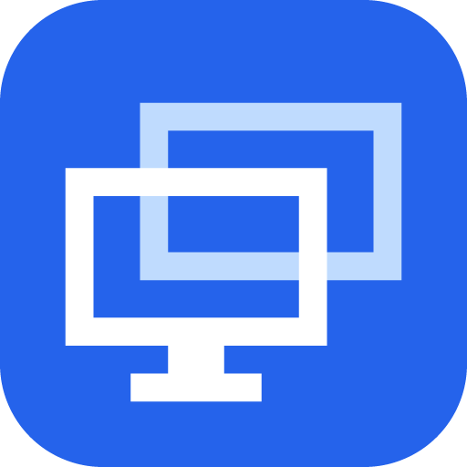

<p align="center">
  
</p>

<h1 align="center">Annex</h1>

<p align="center">
  Use another computer as a second display, or mirror its screen.<br>
  Mac and Windows, in any combination. Over your network or a cable, encrypted end to end.<br>
  Open source (MIT). No cloud, no accounts, no telemetry.
</p>

<p align="center">
  <a href="https://github.com/NRanjan-17/Annex/releases/latest"><b>Download</b></a> ·
  <a href="#quick-start">Quick start</a> ·
  <a href="#troubleshooting">Troubleshooting</a> ·
  <a href="docs/SECURITY.md">Security</a>
</p>

---

## What it does

| | |
|---|---|
| **Mirror** | See and use another computer's screen on this one. |
| **Extend display** | Turn this computer into a **second screen** for the other one: drag windows onto it like a real monitor. |
| **Control** *(optional)* | Use this computer's mouse and keyboard on the other one. Off by default, allowed per device. |

Works **Mac ↔ Mac, Mac ↔ Windows and Windows ↔ Windows**, in either direction.

| | Share its screen | Show another screen |
|---|---|---|
| macOS 14 Sonoma or later | ✅ | ✅ |
| Windows 10 (2004) or Windows 11, x64 or ARM | ✅ | ✅ |

## Install

Download the latest files from **[Releases](https://github.com/NRanjan-17/Annex/releases/latest)**. After that,
Annex keeps itself up to date.

### macOS

1. Download **`Annex-<version>-macos-universal.dmg`** and open it.
2. Drag **Annex** onto **Applications**, then open it.
3. Allow **Local Network** when macOS asks, so Annex can find and reach your other computers.

The Mac app is signed and notarized by Apple, so it opens without warnings.

The first time you **share** this Mac, macOS asks for **Screen Recording**: allow it in
System Settings → Privacy & Security → Screen & System Audio Recording, then turn sharing off and
on again. Letting another computer **control** this Mac also needs **Accessibility** (Annex asks
when you turn it on).

### Windows

1. Download **`Annex-Setup-<version>-x64.exe`** (or `-arm64.exe` for ARM PCs) and run it.
2. The installer isn't code-signed yet, so SmartScreen may say *Windows protected your PC*:
   click **More info → Run anyway**.
3. Choose **just for me** or **all users**, and any folder or drive. Optional: *Install the
   Extend-mode display driver* (see [Extend on Windows](#extend-on-windows)).
4. Annex opens and adds an icon to the system tray, next to the clock.

When Windows asks whether to allow Annex on **private networks**, click **Allow**, or other
computers can't find this PC.

### Linux

Download the package for your system and CPU (`x86_64` for PCs, `arm64` for Raspberry Pi 4/5 on
64-bit Raspberry Pi OS, NVIDIA Jetson and DGX Spark):

```sh
sudo apt install ./Annex-<version>-linux-arm64.deb    # Ubuntu, Debian, Raspberry Pi OS, JetPack, DGX OS
sudo dnf install ./Annex-<version>-linux-x86_64.rpm   # Fedora, RHEL, openSUSE
```

Other distributions: unpack the `.tar.gz` and run `bin/annex`. Open **Annex** from the app menu; it
adds a tray icon where the desktop has a tray (KDE, Raspberry Pi OS, Ubuntu's GNOME).

View and Share are tested on GNOME (NVIDIA Jetson) and Raspberry Pi OS's labwc; KDE, Sway and X11
are built but not yet tested. Extend works on labwc; GNOME, KDE and Sway are built and still being
checked, and X11 has none yet. Details:
[docs/LINUX.md](docs/LINUX.md).

## Quick start

You need two computers on the **same network** (Wi-Fi or Ethernet), or joined by a cable. Open
Annex on both: each shows the other under **Nearby** within a few seconds.

**On the computer whose screen you want to use:**

1. Open **Share This Mac** / **Share this PC** and click **Start Sharing**.

**On the other computer:**

1. Pick the sharing computer under **Nearby**, then choose:
   - **Show its screen here**: see and use the sharing computer's screen.
   - **Extend display**: this computer becomes a second screen for the sharing one.
2. **The first time only**, the sharing computer shows a **6-digit PIN**. Type it here. After
   that, the two connect without a PIN.

The other screen opens full screen. To leave, press **Esc**, or **⌃⌥⇧Q** on a Mac /
**Ctrl+Alt+Shift+Q** on Windows while you're controlling the other computer.

**Not listed under Nearby?** Use **Connect → Connect by address** with one of the addresses the
sharing computer shows. Guest Wi-Fi, VPNs and company networks can hide computers from each other.

## Using it

Preferences are in **Settings** (General, Sharing, Viewing and Developer; on a Mac, press **⌘,**).
**Paired devices** and **About**, with updates, have their own pages at the bottom of the sidebar.

### Extend display

Choose **Extend display** (or turn on *Extend display by default* in
**Settings → Viewing**). The sharing computer gets a new display called **Annex Display**:

- **Mac:** arrange it in System Settings → Displays, and pick its scaling there, from *Larger Text*
  to *More Space* (the same steps as Windows' 100–200 %), and its refresh rate: the same rates
  the other computer's screen supports, so a 144 Hz laptop gets 144 Hz. It starts at the sharpest
  scaling (100 %, or 200 % on a high-resolution screen) and the other computer's refresh rate. To
  change the scaling from Annex, use **Settings → Sharing → Extended display scaling**: it applies
  at once and every time that computer extends this Mac. The steps between 100 % and 200 % give
  bigger text but look a little soft.
- **Windows:** arrange it, and pick its scale and refresh rate, in Settings → System → Display.
  Needs the Extend-mode driver (below).

Neither computer's screen goes to sleep while a session runs.

### Control the other computer

Off by default, and both sides have to agree:

1. On the **sharing** computer: **Paired devices**, turn on control for the device
   you'll use it from. On a Mac, allow **Accessibility** when asked.
2. On the computer you're **sitting at**: **Settings → Viewing → Control the other computer**.

Windows doesn't let any app type into administrator windows or UAC prompts, so those ignore
remote input.

### Paired devices

Every device you pair with a PIN is listed under **Paired devices**. Remove one to make it
enter a PIN again next time. Rename this computer in **Settings → General → Device name**.

### Smoother on Wi-Fi

- **Quality** (Settings → Viewing): *Fast (Wi-Fi)* keeps the picture moving on a busy network;
  *Best* suits a cable or a fast network. Annex also lowers quality by itself as soon as the
  network starts to lag.
- **Direct Wi-Fi** (Mac ↔ Windows, or between PCs): the Windows PC runs its own Mobile hotspot, as
  set up in Windows Settings, and hands its name and password over inside the encrypted session; the other computer joins it and Annex
  reconnects. Video then goes straight between the two, without the router in the middle.
  - **Before you start:** turn on *Connect over direct Wi-Fi* (Windows: Settings → Viewing; Mac:
    the computer's page under Nearby).
  - **During a session:** *Switch to direct Wi-Fi* on the viewing computer, or next to the viewer
    on the sharing computer.
  - **On its own:** *Share this PC → Direct Wi-Fi* runs the hotspot and shows its name and password.

  Needs a PC whose Wi-Fi can run Mobile hotspot.
- On Windows, Annex turns on Wi-Fi's *media streaming mode* (no background scans, no power saving)
  while a session runs.

### Fastest connection: a cable

Annex runs over any cable that makes a **network link** between the two computers, and prefers it
automatically when one is plugged in (shown as *Cable*):

| Computers | Cable |
|---|---|
| Mac ↔ Mac | Thunderbolt or USB4 cable (macOS sets up *Thunderbolt Bridge* by itself) |
| Mac ↔ Windows, Windows ↔ Windows | An Ethernet cable, with a USB-C or USB Ethernet adapter on any computer without a port. Thunderbolt/USB4 networking also works between PCs that support it. |

A plain USB charging or data cable between two computers is **not** a network link, so it doesn't
work. Details: [docs/CABLES.md](docs/CABLES.md).

### A computer somewhere else

Annex has no servers, so over the internet it runs on a private network such as Tailscale or
ZeroTier: install it on both computers, then *Connect by address* with the other computer's VPN
address. Details: [docs/REMOTE.md](docs/REMOTE.md).

### Extend on Windows

Windows has no built-in way for an app to add a display, so when a **Windows PC is sharing**,
Extend uses Annex's own display driver. Tick *Install the Extend-mode display driver* in the
installer (an all-users install). The installer signs the driver **on your PC** with a certificate
made just for it and deletes that certificate's private key straight away, so Windows loads the
driver without test signing and nothing else can ever be signed with it. Uninstalling removes the
driver and the certificate.

**Share this PC** shows whether Extend display is ready. Mirroring, and extending a **Mac**'s display
onto a Windows PC, don't need the driver.

### Updates

Annex checks GitHub at launch and once a day and installs new versions for you (**About →
Updates**). Turn on **Beta updates** to get pre-releases early; turn it off to go back to the
latest normal release. Every update is checked against a signature made when the release is built,
so a modified download is never installed.

On Linux, Annex doesn't update itself yet: download the new package from the releases page and
install it the same way (`sudo apt install ./Annex-<version>-linux-<arch>.deb`).

## Uninstall

- **macOS:** **About → Uninstall…**. It removes the app, its identity key (Keychain),
  paired devices, settings and permissions.
- **Windows:** Settings → Apps → Annex → Uninstall. It removes the app, the display driver, the
  firewall rule, *Start with Windows*, and all settings, keys and paired devices.

## Privacy and security

- Everything stays on your network. There are no Annex servers, accounts or analytics. The only
  internet traffic is the update check to GitHub, which you can turn off.
- Connections use **TLS 1.3** over QUIC with **mutual authentication**. Devices pair once with a
  PIN (SPAKE2), then pin each other's keys, so nobody can impersonate a paired device.
- Identity keys live in the Mac Keychain or Windows DPAPI.

Details: [docs/SECURITY.md](docs/SECURITY.md) · [docs/PROTOCOL.md](docs/PROTOCOL.md).

## Troubleshooting

| Problem | Try this |
|---|---|
| The other computer isn't under **Nearby** | Same network (not guest Wi-Fi or a VPN)? Click **Refresh** next to Nearby. On Windows: **Connect → Not showing up? → Allow** (firewall) and set the network to *Private*. On a Mac: allow Annex in **Privacy & Security → Local Network**. Or use **Connect by address**. |
| It's listed but greyed out | It isn't sharing: click **Start Sharing** on that computer. |
| "Extend display" is greyed out | A sharing Windows PC needs the Extend-mode display driver (installer option). **Share this PC** on that PC says what's missing. |
| Black screen when mirroring a Mac | Allow Screen Recording for Annex (System Settings → Privacy & Security), then turn sharing off and on. |
| Mouse and keyboard do nothing on the other computer | It must allow your device under **Paired devices** (and on a Mac, have Accessibility). Turn on **Settings → Viewing → Control the other computer** on your side. |
| The PIN keeps failing | After 5 wrong PINs, pairing pauses for 10 minutes. Type the PIN shown on the *sharing* computer. |
| Laggy picture | Use a cable or Ethernet instead of Wi-Fi, or try *Direct Wi-Fi*. Keep *Hardware video encoder* on (Settings → Sharing). |

**Reporting a bug?** Turn on **Settings → Developer → Save a log file**, reproduce the problem,
and attach `annex.log` to [an issue](https://github.com/NRanjan-17/Annex/issues).
**Show technical details** in the same place reveals identity codes, addresses and connection
figures.

## Build from source

Prerequisites: [Rust via rustup](https://rustup.rs) (the version is pinned in
`rust-toolchain.toml`), plus Xcode 16+ on macOS, or the .NET 10 SDK and Visual Studio Build Tools
on Windows.

```sh
# Rust core: tests and the latency benchmark
cd core && cargo test --workspace && cargo run --release -p annex-bench

# macOS app (Xcode builds the Rust core automatically)
xcodebuild test -project apps/macos/Annex.xcodeproj -scheme Annex -destination 'platform=macOS'
scripts/package-macos.sh                # → dist/Annex-<version>-macos-universal.dmg

# Windows app (PowerShell). Inno Setup 6 is needed for the installer
cargo build --manifest-path core/Cargo.toml -p annex-ffi --target x86_64-pc-windows-msvc
dotnet build apps/windows/src/Annex.App -p:Platform=x64
scripts/package-windows.ps1 -Arch x64   # → dist/Annex-Setup-<version>-x64.exe

# Headless CLI for testing (host, viewer, discovery, trust management)
cd core && cargo run -p annex-cli -- help
```

**How it's built:** a Rust core (`core/`) handles discovery, pairing, encryption, updates and the
streaming protocol (QUIC with forward error correction and adaptive bitrate, TCP fallback). Native
apps handle capture, hardware video encoding and decoding, and the UI: SwiftUI on macOS
(`apps/macos`), WinUI 3 on Windows (`apps/windows`).

More: [roadmap](docs/PLAN.md) · [manual test plans](docs/TESTING.md) ·
[CI/CD, signing and releases](docs/CICD.md) · [dependencies and licenses](docs/DEPENDENCIES.md).

## Credits

Made by Nalinish Ranjan and [Saidev Dhal](https://saidev.codes).

## License

MIT. See [LICENSE](LICENSE).
