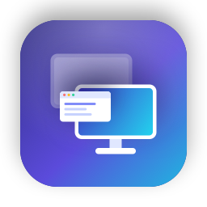

<p align="center">
  
</p>

<h1 align="center">Annex</h1>

<p align="center">
  Use another computer as a second display, or mirror its screen.<br>
  Mac and Windows, in any combination. Over your network or a cable, encrypted end to end.<br>
  Open source (MIT). No cloud, no accounts, no telemetry.
</p>

---

## What it does

| | |
|---|---|
| **Mirror** | See and use another computer's screen on this one. |
| **Extend** | Turn this computer into an **extra display** for the other one: drag windows onto it like a real monitor. |
| **Control** *(optional)* | Use this computer's mouse and keyboard on the other one. Off by default, allowed per device. |

Works **Mac ↔ Mac, Mac ↔ Windows, Windows ↔ Windows**, in either direction.

| | Share its screen (host) | Show another screen (viewer) |
|---|---|---|
| macOS 14 Sonoma or later | ✅ | ✅ |
| Windows 10 (2004) / Windows 11, x64 or ARM | ✅ | ✅ |

> **First release.** The builds aren't code-signed yet, so macOS and Windows warn you the first
> time you open them (the steps below show how to get past that). Please
> [report anything odd](https://github.com/NRanjan-17/Annex/issues).

## Install

Download the latest files from **[Releases](https://github.com/NRanjan-17/Annex/releases)**.

### macOS

1. Download **`Annex-<version>-macos-universal.dmg`** and open it.
2. Drag **Annex** onto **Applications**.
3. Open Annex from Applications. Because the build isn't signed by Apple yet, macOS says it
   *can't check it for malicious software*. Click **Done**, then open
   **System Settings → Privacy & Security**, scroll down and click **Open Anyway** next to Annex.
   You only do this once.
4. Annex opens its window and adds an icon to the menu bar.

The first time you **share** this Mac, macOS asks for **Screen Recording** permission: allow
it in System Settings → Privacy & Security → Screen & System Audio Recording, then turn
sharing off and on again. Letting another computer **control** this Mac also needs
**Accessibility** permission (Annex asks when you turn it on).

### Windows

1. Download **`Annex-Setup-<version>-x64.exe`** (or `-arm64.exe` for ARM PCs) and run it.
2. Windows SmartScreen may say *Windows protected your PC*: click **More info → Run anyway**.
3. Choose **just for me** or **all users**, and any folder or drive. Optional:
   *Install the Extend-mode display driver* (see [Extend on Windows](#extend-on-windows)).
4. Annex opens and adds an icon to the system tray (next to the clock).

When Windows asks whether to allow Annex on **private networks**, click **Allow**, or other
computers can't find this PC.

## Quick start

You need two computers on the **same network** (Wi-Fi or Ethernet), or joined by a cable.

Open Annex on both. Each computer shows the other under **Nearby** within a few seconds
(marked *not sharing* until it shares).

**On the computer whose screen you want to use (the one sharing):**

1. **Share This Mac** / **Share this PC** → click **Start Sharing**.
2. Annex shows *How to connect from the other computer*, with this computer's name and its
   addresses (for example `192.168.1.20`).

**On the other computer:**

1. **Connect** (or the computer's name under **Nearby**), then choose:
   - **Show its screen here**: see and use the sharing computer's screen.
   - **Be its extra display**: this computer becomes a second screen for the sharing one.
3. **The first time only**, the sharing computer shows a **6-digit PIN**. Type it here and
   check that the *identity code* matches on both screens. After that the two connect without a PIN.

The other screen opens full screen. To leave, press **Esc** (or **⌃⌥⇧Q** on Mac /
**Ctrl+Alt+Shift+Q** on Windows while you're controlling the other computer).

**Doesn't appear under Nearby?** Go to **Connect → Connect by address** and type one of the
addresses the sharing computer shows. Discovery can be blocked by guest Wi-Fi, VPNs or
company networks.

## Using it

### Extra display (Extend)

Choose **Extend** (or set *Use as an extra display by default* under **Viewing**). The
sharing computer gets a new display called **Annex Display**:

- **Mac:** arrange it in System Settings → Displays, and pick its resolution there.
- **Windows:** arrange it in Settings → System → Display. Needs the Extend-mode driver (below).

### Control the other computer

Off by default, and both sides have to agree:

1. On the **sharing** computer: **Paired Devices** → turn on **Control** (Mac) / **Can control**
   (Windows) for the device you'll control it from. On a Mac, allow **Accessibility** when asked.
2. On the computer you're **sitting at**: **Viewing → Control the other computer** → on.

Windows doesn't let any app type into administrator windows or UAC prompts, so those ignore
remote input.

### Paired devices

Every device you pair with a PIN is listed under **Paired Devices**. Remove one to make it
enter a PIN again next time. Rename this computer under **General → Device name** (leave it
empty to use the computer's own name).

### Smoother on Wi-Fi

- **Quality** (Viewing page): *Fast (Wi-Fi)* lowers the bitrate so the picture keeps up on a
  busy network; *Best* is for a cable or a fast network. Annex also lowers quality by itself as
  soon as the network delay starts creeping up.
- **Direct Wi-Fi** (Mac ↔ Windows, or between PCs): the Windows PC runs its own hotspot with a
  random password and hands it over inside the encrypted session; the other computer joins it and
  Annex reconnects. Video then goes straight between the two, one Wi-Fi hop instead of two through
  the router. Use it either way:
  - **Before you start:** turn on *Connect over direct Wi-Fi* (Windows: Connect page; Mac: the
    computer's page). Each session moves onto the hotspot right after it connects.
  - **During a session:** *Switch to direct Wi-Fi* on the viewing computer, or next to the viewer
    on the sharing computer.
  On Windows, *Share this PC → Direct Wi-Fi* also runs the hotspot on its own and shows its name
  and password. Needs a PC whose Wi-Fi can run Mobile hotspot.
- On Windows, Annex puts Wi-Fi in *media streaming mode* (no background scans, no power saving)
  while a session runs.

### Fastest connection: a cable (USB-C, Thunderbolt or Ethernet)

Annex runs over any cable that makes a **network link** between the two computers, and
prefers it automatically when one is plugged in (shown as *direct cable*):

| Computers | Cable |
|---|---|
| Mac ↔ Mac | Thunderbolt / USB4 cable (macOS sets up *Thunderbolt Bridge* by itself) |
| Mac ↔ Windows, Windows ↔ Windows | An Ethernet cable, with a USB-C/USB-Ethernet adapter on any computer without a port. Thunderbolt/USB4 networking also works between PCs that support it. |

A plain USB-A or USB-C *charging/data* cable between two computers is **not** a network link,
so it doesn't work. Details: [docs/CABLES.md](docs/CABLES.md).

### Extend on Windows

Windows has no built-in way for an app to add a display, so when a **Windows PC is sharing**,
Extend uses Annex's own display driver. Tick *Install the Extend-mode display driver* in the
installer (an all-users install). The installer signs the driver **on your PC** with a
certificate made just for it and deletes that certificate's private key straight away, so
Windows loads the driver without test signing and nothing else can ever be signed with it.
Uninstalling removes the driver and the certificate.

**Share this PC** shows whether extra displays are ready. Mirroring, and using a Windows PC as
an extra display for a **Mac**, don't need the driver.

### Updates

Annex checks GitHub for a new version at launch and once a day, and offers to install it
(**Settings → General**). Turn on **Beta updates** to get pre-releases early; turn it off to go
back to the latest normal release. Every update is checked against a signature made when the
release is built, so a modified download is never installed. Turn off *Check for updates
automatically* if you'd rather check by hand.

## Uninstall

- **macOS:** in Annex, open **About** and click **Uninstall…**. It removes the app, its
  identity key (Keychain), paired devices, settings and permissions.
- **Windows:** Settings → Apps → Annex → Uninstall. It removes the app, the display driver,
  the firewall rule, *Start with Windows*, and all settings, keys and paired devices.

## Privacy and security

- Everything stays on your network. There are no Annex servers, accounts or analytics. The only
  internet traffic is the update check to GitHub, which you can turn off.
- Connections use **TLS 1.3** (over QUIC) with **mutual authentication**. Devices pair once
  with a PIN (SPAKE2), then pin each other's keys, so nobody can impersonate a paired device.
- Identity keys live in the Mac Keychain or Windows DPAPI.

Details: [docs/SECURITY.md](docs/SECURITY.md) · [docs/PROTOCOL.md](docs/PROTOCOL.md).

## Troubleshooting

| Problem | Try this |
|---|---|
| The other computer doesn't show under **Nearby** | Same network (not guest Wi-Fi or a VPN)? On Windows: **Connect → Not showing up? → Allow** (firewall) and set the network to *Private*. On Mac: allow Annex in **Privacy & Security → Local Network**. Or use **Connect by address**. |
| It shows *not sharing* | Click **Start Sharing** on that computer. |
| "Be its extra display" is greyed out, or "can't add an extra display" | A sharing Windows PC needs the Extend-mode display driver (installer option). **Share this PC** on that PC says what's missing. |
| Black screen when mirroring a Mac | Allow Screen Recording for Annex (System Settings → Privacy & Security), then turn sharing off and on. |
| "Annex can't be opened" on Mac | System Settings → Privacy & Security → **Open Anyway** (see Install). |
| Mouse/keyboard does nothing on the other computer | It must allow your device under **Paired Devices**, and on a Mac have Accessibility permission. Turn on **Viewing → Control the other computer** on your side. |
| PIN keeps failing | After 5 wrong PINs pairing pauses for 10 minutes. Make sure you type the PIN shown on the *sharing* computer. |
| Laggy picture | Use Ethernet or a cable instead of Wi-Fi, keep *Hardware video encoder* on, and close bandwidth-heavy apps. |

## Build from source

Prerequisites: [Rust via rustup](https://rustup.rs) (the version is pinned in
`rust-toolchain.toml`), plus Xcode 16+ on macOS or the .NET 10 SDK and Visual Studio Build
Tools on Windows.

```sh
# Rust core: tests and the latency benchmark
cd core && cargo test --workspace && cargo run --release -p annex-bench

# macOS app (Xcode builds the Rust core automatically)
xcodebuild test -project apps/macos/Annex.xcodeproj -scheme Annex -destination 'platform=macOS'
scripts/package-macos.sh                # → dist/Annex-<version>-macos-universal.dmg

# Windows app (PowerShell). Inno Setup 6 is needed for the installer
cargo build --manifest-path core/Cargo.toml -p annex-ffi --target x86_64-pc-windows-msvc
dotnet build apps/windows/src/Annex.App -p:Platform=x64
scripts/package-windows.ps1 -Arch x64   # → dist/Annex-Setup-<version>-x64.exe

# Headless CLI for testing (host / viewer / discovery / trust management)
cd core && cargo run -p annex-cli -- help
```

How it's built: a Rust core (`core/`) handles discovery, pairing, encryption and the
streaming protocol (QUIC with forward error correction and adaptive bitrate, TCP fallback).
Native apps handle capture, hardware video encoding/decoding and the UI: SwiftUI on macOS
(`apps/macos`), WinUI 3 on Windows (`apps/windows`).

More: [roadmap](docs/PLAN.md) · [manual test plans](docs/TESTING.md) ·
[CI/CD, signing and releases](docs/CICD.md) · [dependencies and licenses](docs/DEPENDENCIES.md).

## License

MIT. See [LICENSE](LICENSE).
